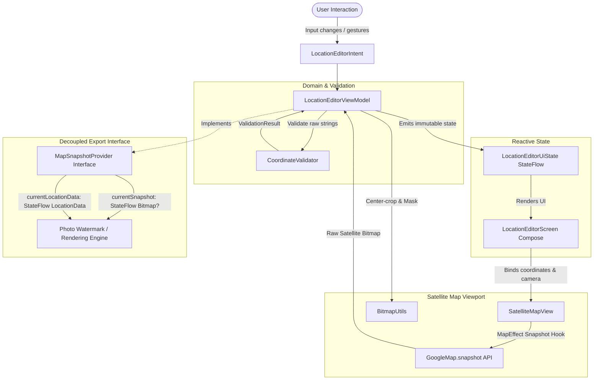

# GPS Photo Camera — GPS Location Editor & Satellite Map Module

[](https://developer.android.com)
[](https://kotlinlang.org)
[](https://developer.android.com/jetpack/compose)
[](https://developers.google.com/maps/documentation/android-sdk)
[](https://developer.android.com/topic/architecture)
[](https://m3.material.io)
[](LICENSE)

A native Android module built with **Kotlin**, **Jetpack Compose**, **Google Maps SDK for Android (Satellite View)**, and **MVVM architecture**.

This module powers the manual location editing and satellite map thumbnail watermark badge for the **GPS Photo Camera** application. It allows users to manually specify any global coordinates and address information (independent of device GPS hardware) and generates a cropped satellite map thumbnail featuring the iconic red location pin marker.

---

## Table of Contents

- [Overview & Key Features](#-overview--key-features)
- [Architecture & Data Flow](#-architecture--data-flow)
- [Technology Stack](#-technology-stack)
- [Manual Location Editing](#-manual-location-editing)
- [Satellite Map Implementation](#-satellite-map-implementation)
- [Coordinate Validation Engine](#-coordinate-validation-engine)
- [Map Thumbnail Generation & Image Integration](#-map-thumbnail-generation--image-integration)
- [Project Directory Structure](#-project-directory-structure)
- [Setup & Configuration](#-setup--configuration)
  - [Google Maps API Key](#1-google-maps-api-key)
  - [Building in Android Studio](#2-building-in-android-studio)
- [Testing](#-testing)
  - [Running Unit Tests](#running-unit-tests)
  - [Manual Test Checklist](#manual-test-checklist)
- [Contributing & License](#-contributing--license)

---

## 🌟 Overview & Key Features

- **100% Manual Location Control:** Freedom to specify or override any address field, postal code, and global latitude/longitude without forcing device GPS hardware.
- **Pure Satellite Imagery:** Real-time satellite imagery via `GoogleMap.MAP_TYPE_SATELLITE`.
- **Custom Red Location Marker:** Visually identical to the reference GPS Map Camera red location marker with 3D gradient body, concentric white center ring, deep crimson core, and contact ground shadow.
- **Interactive Two-Way Camera Sync:**
  - Typing coordinates animates the satellite camera to the target coordinates.
  - Tapping or dragging the map synchronizes the exact coordinates back to the manual input fields with 6 decimal places of precision.
- **Fail-Safe Coordinate Validation:** Strict bounds checking (`[-90.0, +90.0]` latitude, `[-180.0, +180.0]` longitude), format sanitization (handles comma decimals, whitespace, negatives), and non-crashing inline error messaging.
- **Satellite Snapshot Generator:** In-memory capture via Google Maps SDK `snapshot()` API, custom center-cropping, resolution scaling, antialiased corner rounding, and border rendering.
- **Multiple Thumbnail Aspect Ratios & Presets:**
  - Standard Stamp (360×360 px, 1:1)
  - High-Definition Stamp (600×600 px, 1:1)
  - Landscape Stamp (480×360 px, 4:3)
  - Circle Badge (320×320 px)
- **Decoupled Architecture:** Clean `MapSnapshotProvider` interface exposing StateFlow streams to the photo watermarking/rendering engine without tight coupling to Compose or Google Maps SDK.
- **Watermark Simulation Preview:** Embedded interactive dialog simulating the photo watermark badge on a live photograph viewfinder.

---

## 🏗 Architecture & Data Flow

The project is built on **Model-View-ViewModel (MVVM)** with unidirectional data flow and `StateFlow`:



---

## 🛠 Technology Stack

| Layer | Component | Version / Description |
|---|---|---|
| **Language** | Kotlin | `1.9.24` / `2.0.0` |
| **UI Framework** | Jetpack Compose | BOM `2024.05.00` |
| **Design System** | Material 3 | `1.2.1` with Dark Theme styling |
| **Maps SDK** | Google Maps SDK for Android | `play-services-maps:19.0.0` |
| **Maps Compose** | Google Maps Compose Extension | `maps-compose:4.4.1` |
| **Architecture** | MVVM + Unidirectional Data Flow | ViewModel Compose `2.8.0` |
| **Concurrency** | Kotlin Coroutines & Flow | `1.8.1` (`StateFlow`, `SharingStarted`) |
| **Security** | Secrets Gradle Plugin | `2.0.1` (keeps API keys out of VCS) |
| **Graphics** | Android Bitmap / Canvas APIs | `PorterDuffXfermode`, `RadialGradient`, `LinearGradient` |

---

## 📝 Manual Location Editing

The location information form exposes eight fully editable fields:

| Field | Purpose | Reference Example |
|---|---|---|
| **Location Heading** | High-level place name / label | `Pune, Maharashtra, India` |
| **City** | Municipality / District | `Pune` |
| **State** | State / Region / Province | `Maharashtra` |
| **Country** | Nation | `India` |
| **Complete Postal Address** | Detailed street address | `40/34, Near Prime Furnishings, Bhonde Colony, Erandwane, Pune, Maharashtra 411004, India` |
| **Postal PIN Code** | Area postal code | `411004` |
| **Latitude** | Decimal degrees `[-90.0, +90.0]` | `18.511347` |
| **Longitude** | Decimal degrees `[-180.0, +180.0]` | `73.833891` |

Quick preset chips are included for one-tap global testing:
- **Pune (Reference)**
- **New York (Western/Northern Hemisphere)**
- **Sydney (Southern/Eastern Hemisphere)**
- **Tokyo (Eastern Hemisphere)**

---

## 🛰 Satellite Map Implementation

- **Map Type:** Initialized with `GoogleMap.MAP_TYPE_SATELLITE` via Compose:
  ```kotlin
  val mapProperties = remember {
      MapProperties(mapType = MapType.SATELLITE, isBuildingEnabled = true)
  }
  ```
- **Red Location Marker Pin (`RedLocationMarker.kt`):**
  - High-contrast crimson body with 3D depth gradient (`#FF5252` $\rightarrow$ `#E53935` $\rightarrow$ `#B71C1C`).
  - Concentric white center ring with crimson inner dot.
  - Realistic contact shadow at the anchor point on the satellite surface.
  - Precise bottom-tip anchor: `Offset(0.5f, 1.0f)`.
- **Clutter-Free Snapshot Viewport:** Compass, default zoom buttons, toolbar, and device location buttons are hidden to prevent UI clutter from burning into the captured satellite watermark.

---

## 🛡 Coordinate Validation Engine

Implemented in [`CoordinateValidator.kt`](app/src/main/java/com/gpsphotocamera/locationeditor/validation/CoordinateValidator.kt):

- **Latitude Constraints:** Validates within `[-90.0, +90.0]`.
- **Longitude Constraints:** Validates within `[-180.0, +180.0]`.
- **Error Handling:**
  - Empty or whitespace inputs.
  - Multiple decimal points (e.g. `18.51.134`).
  - Non-numerical characters or invalid signs (e.g. `18.abc`, `--73.8`).
  - Out-of-bounds coordinates (e.g. `90.0001`, `195.0`).
- **Resilience:** Employs `toDoubleOrNull()` with validation models so the UI updates with inline warnings instead of crashing with `NumberFormatException`.
- **Sanitization:** Automatically replaces commas with decimal dots (`18,511347` $\rightarrow$ `18.511347`) and trims extra spaces.

---

## 📸 Map Thumbnail Generation & Image Integration

### Center-Cropping & Shaping (`BitmapUtils.kt`)
When capturing the satellite view:
1. **Center-Crop:** Crops from the exact center of the map viewport so the target coordinates and red marker stay centered.
2. **Aspect Ratio:** Automatically transforms to Square (1:1), Standard (4:3), or Wide (16:9).
3. **Shape Masking:** Clips using antialiased paths into rounded rectangles or circular badges.
4. **Border Stroke:** Draws a crisp, high-contrast outer border stroke to make the badge pop against any camera photo background.

### Decoupled Interface (`MapSnapshotProvider.kt`)
External image rendering, photo watermarking, or EXIF injection modules consume the map snapshot through a clean interface:

```kotlin
interface MapSnapshotProvider {
    val currentSnapshot: StateFlow<Bitmap?>
    val currentLocationData: StateFlow<LocationData>
    fun captureMapSnapshot(config: ThumbnailConfig, onComplete: (Bitmap?) -> Unit)
}
```

---

## 📂 Project Directory Structure

```
GPS-Photo-Editior/
├── app/
│   ├── build.gradle.kts
│   ├── proguard-rules.pro
│   └── src/
│       ├── main/
│       │   ├── AndroidManifest.xml
│       │   ├── java/com/gpsphotocamera/locationeditor/
│       │   │   ├── MainActivity.kt
│       │   │   ├── GpsPhotoCameraApp.kt
│       │   │   ├── model/
│       │   │   │   ├── LocationData.kt
│       │   │   │   ├── CoordinateValidationResult.kt
│       │   │   │   └── ThumbnailConfig.kt
│       │   │   ├── validation/
│       │   │   │   └── CoordinateValidator.kt
│       │   │   ├── snapshot/
│       │   │   │   ├── MapSnapshotProvider.kt
│       │   │   │   └── BitmapUtils.kt
│       │   │   ├── viewmodel/
│       │   │   │   ├── LocationEditorUiState.kt
│       │   │   │   ├── LocationEditorIntent.kt
│       │   │   │   └── LocationEditorViewModel.kt
│       │   │   └── ui/
│       │   │       ├── theme/
│       │   │       │   ├── Color.kt
│       │   │       │   ├── Type.kt
│       │   │       │   └── Theme.kt
│       │   │       ├── components/
│       │   │       │   ├── RedLocationMarker.kt
│       │   │       │   ├── SatelliteMapView.kt
│       │   │       │   ├── MapControlsBar.kt
│       │   │       │   ├── CoordinateInputCard.kt
│       │   │       │   ├── LocationFormCard.kt
│       │   │       │   ├── ThumbnailPreviewDialog.kt
│       │   │       │   └── PhotoStampSampleOverlay.kt
│       │   │       └── screen/
│       │   │           └── LocationEditorScreen.kt
│       │   └── res/
│       └── test/
│           └── java/com/gpsphotocamera/locationeditor/
│               └── CoordinateValidatorTest.kt
├── gradle/
│   ├── libs.versions.toml
│   └── wrapper/
│       ├── gradle-wrapper.properties
│       └── gradle-wrapper.jar
├── build.gradle.kts
├── settings.gradle.kts
├── gradle.properties
├── gradlew
├── gradlew.bat
├── secrets.properties.example
└── README.md
```

---

## ⚙️ Setup & Configuration

### 1. Google Maps API Key
1. Go to the [Google Cloud Console](https://console.cloud.google.com/).
2. Create or select a project.
3. Enable **Maps SDK for Android** in **APIs & Services > Library**.
4. Generate an API Key under **APIs & Services > Credentials**.
5. *(Recommended)* Restrict the key to Android apps with package name `com.gpsphotocamera.locationeditor` and your SHA-1 fingerprint.
6. Create or edit `secrets.properties` in the project root:
   ```properties
   MAPS_API_KEY=AIzaSyYourActualGoogleMapsApiKeyHere
   ```
   *(The `secrets-gradle-plugin` automatically injects this value into the AndroidManifest at build time).*

### 2. Building in Android Studio
1. Clone the repository:
   ```bash
   git clone https://github.com/Yashborse4/GPS-Photo-Editior.git
   ```
2. Open the project in Android Studio (Hedgehog 2023.1.1 or later).
3. Let Gradle sync dependencies.
4. Run on an Android device or emulator with Google Play Services (API 24+).

---

## 🧪 Testing

### Running Unit Tests
A full JUnit 4 test suite is located in [`CoordinateValidatorTest.kt`](app/src/test/java/com/gpsphotocamera/locationeditor/CoordinateValidatorTest.kt).

Run tests from the terminal:
```bash
./gradlew testDebugUnitTest
```
Or in Windows PowerShell:
```powershell
.\gradlew.bat testDebugUnitTest
```

### Manual Test Checklist
- [x] **Default Reference Launch:** App opens centered on Pune, India (`18.511347`, `73.833891`) with satellite tiles and red pin.
- [x] **Field Editing:** Modifying any location field updates the state immediately without GPS hardware dependency.
- [x] **Preset Switching:** Clicking preset chips (New York, Sydney, Tokyo) updates inputs and animates the satellite camera.
- [x] **Two-Way Sync:** Dragging or tapping the map updates latitude and longitude to 6 decimal places.
- [x] **Coordinate Validation:** Entering invalid coordinates (e.g. `95.0` or text) displays inline red error text without crashing.
- [x] **Snapshot Generation:** Tapping Snapshot captures the satellite view, center-crops the marker, and opens the preview dialog.
- [x] **Photo Watermark Simulation:** Tapping Stamp Preview opens the camera overlay showing the satellite badge and metadata watermark.

---

## 📄 License

```
Copyright 2026 Yash Borse

Licensed under the Apache License, Version 2.0 (the "License");
you may not use this file except in compliance with the License.
You may obtain a copy of the License at

    http://www.apache.org/licenses/LICENSE-2.0

Unless required by applicable law or agreed to in writing, software
distributed under the License is distributed on an "AS IS" BASIS,
WITHOUT WARRANTIES OR CONDITIONS OF ANY KIND, either express or implied.
See the License for the specific language governing permissions and
limitations under the License.
```
