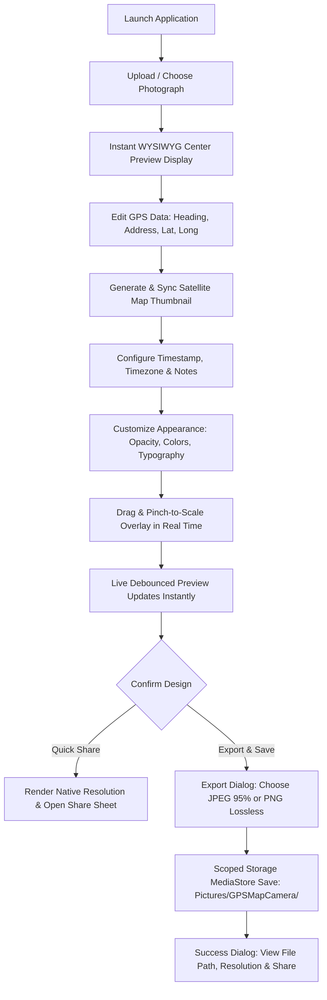

# Advanced GPS Photo Camera – Live Preview and Customization Editor

[](https://developer.android.com)
[](https://kotlinlang.org)
[](https://developer.android.com/jetpack/compose)
[](https://m3.material.io)
[](https://developer.android.com/topic/architecture)
[-brightgreen.svg)]()
[-success.svg)]()

A complete native Android application engineered with **Kotlin**, **Jetpack Compose (Material 3)**, **MVVM with StateFlow**, and a **Resolution-Independent Canvas Rendering Engine**.

Designed to replicate the exact visual aesthetics, crisp typography, and layout proportions of the classic **GPS Map Camera** reference photograph while introducing real-time live preview editing, interactive touch positioning, visual customization panels, and full-resolution export.

---

## Table of Contents

1. [Main Application Workflow](#-main-application-workflow)
2. [Live Preview Editor & Interactive Positioning](#-live-preview-editor--interactive-positioning)
3. [Visual Customization Controls](#-visual-customization-controls)
4. [Layout Presets](#-layout-presets)
5. [High-Resolution Rendering & Export Engine](#-high-resolution-rendering--export-engine)
6. [Architecture & Technology Stack](#-architecture--technology-stack)
7. [Project Directory Structure](#-project-directory-structure)
8. [Build & Installation Guide](#-build--installation-guide)
9. [Running Unit & UI Tests](#-running-unit--ui-tests)
10. [Reliability & Edge Case Handling](#-reliability--edge-case-handling)

---

## 🚀 Main Application Workflow

The app delivers the complete, seamless end-to-end workflow:



---

## 🎨 Live Preview Editor & Interactive Positioning

The live preview editor is the centerpiece of the application:
- **Instant Reactive Updates:** Any modification to location heading, postal address, latitude, longitude, date, time, timezone, custom notes, font size, panel transparency, or position immediately updates the live preview without requiring manual "Generate" clicks.
- **Direct Touch Gestures on Preview:**
  - **Drag to Move:** Drag anywhere across the photo to position the overlay panel smoothly. Position is tracked in normalized coordinates `(normX, normY)` relative to photo width and height (`[0.0, 1.0]`).
  - **Pinch to Scale:** Multi-touch gesture scaling dynamically adjusts panel scale from `0.6x` to `1.8x`.
  - **One-Tap Reset:** Instant "Reset Position" action restores calibrated default bottom-centered orientation.
- **Resolution Independence:** The exact normalized position `(normX, normY)` and scale factor are mapped 1:1 onto the full-resolution photograph during final export.

---

## 🎛 Visual Customization Controls

Organized into clean, animated **Collapsible Sections** to prevent excessive scrolling:

### 1. Panel & Appearance Controls
- **Background Opacity Slider:** Real-time alpha adjustment from 10% to 100%.
- **Panel Width Slider:** Adjusts width from 60% to 100% of the photograph.
- **Corner Radius Slider:** Custom corner rounding from 0 dp (sharp) to 32 dp (pill).
- **Vertical Padding Slider:** Custom internal content spacing from 4 dp to 24 dp.
- **Position Sliders:** Granular manual adjustments for Horizontal (`normX`) and Vertical (`normY`) anchors.
- **Background Color Palette:** Deep Carbon Black, Midnight Slate, Charcoal Gray, Dark Navy.

### 2. Typography Controls
- **Font Family Selector:** Default Sans-Serif, Monospace, and Serif.
- **Font Size Scale Slider:** Multiplier from 70% to 150%.
- **Bold Toggle:** Emphasizes headings and tags.
- **Text Color Palette:** Pure White, Crisp Off-White, Golden Yellow, Sky Blue, Emerald Green.
- **Accent Color Palette:** Reference Red (`#FF3B30`), Cyan Blue, Emerald Green, Amber Orange.
- **Line Spacing Slider:** Fine-tune spacing between metadata lines from 1 dp to 8 dp.
- **Text Alignment:** Left, Center, or Right alignment.

### 3. Satellite Map Controls
- **Interactive Viewport:** Google Maps SDK camera synced to target coordinates.
- **Map Types:** Satellite, Normal Roadmap, Terrain, and Hybrid imagery.
- **Map Thumbnail Size Slider:** Scale factor from 60% to 160%.
- **Map Zoom Slider:** Dynamic zoom level adjustment from 10x to 20x.
- **Aspect Ratio Options:** 1:1 Square, 4:3 Landscape, and 16:9 Wide.
- **Visual Indicators:** Toggles for glowing red location pin marker and compass rose indicator.

### 4. Date & Time Editor
- **Native Android Dialogs:** Material 3 `DatePickerDialog` and `TimePickerDialog`.
- **Timezone Selector:** Comprehensive GMT/UTC timezone selector dialog.
- **Manual Overrides:** Full freedom to edit date strings, timestamps, and day-of-week without automatic replacement by the device clock.

---

## 📐 Layout Presets

| Preset | Description | Visual Characteristics |
|---|---|---|
| **GPS Map Camera Classic** | **Exact reproduction of reference photograph** | Dark translucent card (~72% opacity), square satellite thumbnail on left with red marker and compass rose; title, address, coordinates, altitude, heading, date/time, custom note, and top-right "GPS Map Camera" badge on right. |
| **Compact GPS Overlay** | Streamlined low-profile banner | Compact height, thumbnail on left, two-line essential coordinates and timestamp for minimal photo obstruction. |
| **Large Location Card** | Spacious modern floating card | Elevated card with wide landscape map preview, full address block, and structured metadata grid. |
| **Minimal Location Overlay** | Clean watermark pill | Floating translucent pill displaying location title, coordinates, and timestamp centered at the bottom. |

---

## 💾 High-Resolution Rendering & Export Engine

- **Original Resolution Preservation:** The preview is optimized for responsive 60fps Compose interaction, but the final export decodes and stamps the **original full-resolution photograph** (e.g. 12MP to 108MP) without downscaling.
- **Native Canvas & StaticLayout:** Uses Android Canvas with multi-line `StaticLayout` text wrapping and custom anti-aliased path clipping.
- **Export Formats:**
  - **JPEG:** High-quality 95% compression with minimal file footprint.
  - **PNG:** Lossless quality for publication and archival purposes.
- **Scoped Storage MediaStore:** Saves directly to `Pictures/GPSMapCamera/` compliant with Android 10+ (API 29-35) and legacy storage.
- **Native Share Sheet:** Instant sharing via `FileProvider` (`ACTION_SEND`).
- **Export Confirmation Dialog:** Displays exported dimensions, file path, and instant Share and Done actions.

---

## 🏛 Architecture & Technology Stack

- **Language:** Kotlin 2.0.21
- **UI Framework:** Jetpack Compose with Material 3 (BOM 2024.10.01)
- **Architecture:** MVVM (Model-View-ViewModel) + Unidirectional Data Flow + StateFlow
- **Graphics Engine:** Android Canvas, Paint, Path, StaticLayout, Matrix, Bitmap
- **Maps Integration:**
  - **OpenStreetMap (OSM):** Native asynchronous Web Mercator 3x3 tile grid downloader with sub-pixel cropping and zero API keys required (`tile.openstreetmap.org`, Esri World Imagery, OpenTopoMap)
  - **Google Maps SDK for Android:** `play-services-maps:19.0.0` & Maps Compose `6.1.2`
  - **Offline Vector Synthesis:** Built-in vector map engine when offline
- **Image Loading:** Coil Compose (`2.7.0`)
- **Metadata:** AndroidX ExifInterface (`1.3.7`)
- **Concurrency:** Kotlin Coroutines (`Dispatchers.Default`, `Dispatchers.IO`, `Dispatchers.Main`)
- **Storage:** Android MediaStore Scoped Storage + FileProvider

---

## 📁 Project Directory Structure

```
app/src/main/java/com/gpsphotocamera/app/
├── GpsCameraApp.kt                         # Application singleton
├── MainActivity.kt                         # Edge-to-edge Compose host Activity
├── PlaceHolder.java                        # Java compiler compatibility anchor
├── data/
│   ├── model/
│   │   ├── AppMapType.kt                   # Satellite, Normal, Terrain, Hybrid
│   │   ├── GpsPhotoData.kt                 # Complete immutable state & styling model
│   │   ├── SavedPhotoItem.kt               # Recent exported history entity
│   │   └── StampStyle.kt                   # 4 Layout Presets (Classic, Compact, Card, Minimal)
│   └── repository/
│       └── RecentPhotosRepository.kt       # Local persistent export history
├── domain/
│   └── usecase/
│       ├── GenerateOverlayUseCase.kt       # Preview rendering coordinator
│       └── SavePhotoUseCase.kt             # MediaStore gallery saving coordinator
├── image/
│   ├── BitmapHolder.kt                     # Active in-memory bitmap holder
│   ├── BitmapUtils.kt                      # EXIF orientation, full-res decoding, sample generator
│   ├── CanvasOverlayRenderer.kt            # Resolution-independent Canvas graphics engine
│   └── ExifExtractor.kt                    # EXIF latitude, longitude, and timestamp reader
├── maps/
│   └── MapSnapshotHelper.kt                # Online static map fetcher & offline vector synthesizer
├── ui/
│   ├── components/
│   │   ├── AppTopBar.kt                    # Material 3 top app bar
│   │   ├── CollapsibleSection.kt           # Animated expandable card section
│   │   ├── ColorPickerRow.kt               # Circular palette swatches
│   │   ├── DateTimePickerDialogs.kt        # Date, time, and timezone dialogs
│   │   ├── ExportDialogs.kt                # Export format selector & success dialog
│   │   ├── InteractivePhotoPreview.kt      # Live preview with drag and pinch gesture support
│   │   ├── LiveOverlayView.kt              # Compose live preview for all 4 layout presets
│   │   ├── LoadingOverlay.kt               # Progress dialog overlay
│   │   ├── RoundedTextField.kt             # Styled Material 3 text field
│   │   ├── SatelliteMapCard.kt             # Interactive Compose GoogleMap card
│   │   └── StampStyleSelector.kt           # Preset selector chips
│   ├── navigation/
│   │   ├── AppNavHost.kt                   # Screen navigation router
│   │   └── NavRoutes.kt                    # Type-safe routes
│   ├── screens/
│   │   ├── editor/PhotoEditorScreen.kt     # Live Preview Editor with all controls
│   │   ├── home/HomeScreen.kt              # Gallery picker & recent exports feed
│   │   └── preview/PreviewScreen.kt        # Fullscreen inspect & pan/zoom screen
│   └── theme/
│       ├── Color.kt, Shape.kt, Theme.kt, Type.kt
├── utils/
│   ├── AppDateTimeFormatter.kt             # Date/time formatting utilities
│   ├── MediaStoreHelper.kt                 # Scoped storage JPEG/PNG saving
│   ├── PermissionUtils.kt                  # Runtime location & storage permission handler
│   └── ShareHelper.kt                      # System share sheet launcher
└── viewmodel/
    ├── EditorViewModel.kt                  # Live preview state & export ViewModel
    ├── HomeViewModel.kt                    # Home screen history ViewModel
    └── PreviewViewModel.kt                 # Fullscreen preview ViewModel
```

---

## 🛠 Build & Installation Guide

### Prerequisites
- **JDK:** Java 21 (Amazon Corretto 21 or Oracle OpenJDK 21)
- **Android SDK:** Compile SDK 35, Min SDK 26 (Android 8.0+)
- **Android Studio:** Ladybug (2024.2.1+) or newer

### Building Debug APK via Command Line
```powershell
# Clean and assemble debug APK
.\gradlew.bat clean assembleDebug

# Output APK location:
# app/build/outputs/apk/debug/app-debug.apk
```

### Installing onto Connected Android Device / Emulator
```powershell
# Install debug build directly to adb device
.\gradlew.bat installDebug
```

---

## 🧪 Running Unit & UI Tests

### 1. JVM Unit Tests (19/19 Passing)
Tests cover default state, coordinate formatting (positive, negative, southern/western hemispheres), timezone formatting, preset styling parameters, normalized positioning reset, cardinal bearing directions, and boundary handling for long strings.

```powershell
.\gradlew.bat testDebugUnitTest
```

HTML Test Report generated at:
`app/build/reports/tests/testDebugUnitTest/index.html`

### 2. Instrumented Compose UI Tests
```powershell
.\gradlew.bat connectedAndroidTest
```

---

## 🛡 Reliability & Edge Case Handling

- **Offline Satellite Map Fallback:** When Google Maps imagery is unavailable or the device is offline, `MapSnapshotHelper` automatically synthesizes an authentic vector satellite map tile with terrain shading, water bodies, road grids, and compass rose without crashing.
- **Negative Coordinates:** Verified with locations across the Southern and Western hemispheres (e.g. Sydney `-33.8688° S`, Santiago `-70.6692° W`).
- **Memory Safety:** Employs subsampled bitmaps for 60fps Compose interaction and dynamically switches to full-resolution decoding during final rendering, backed by graceful 4K fallback to prevent `OutOfMemoryError`.
- **Text Wrapping:** Long addresses and survey notes wrap seamlessly using Android `StaticLayout` without clipping or overflowing the card.
